# 🎨 GuessMaster

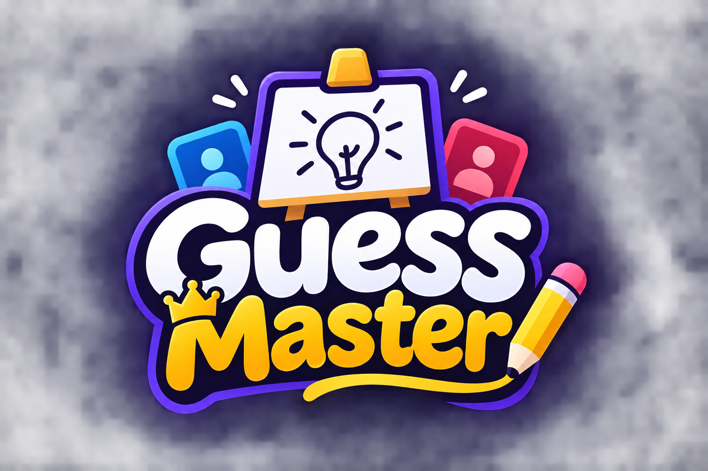

**GuessMaster** is a fun, real-time multiplayer drawing and word-guessing game. Players join a room, take turns drawing secret words, and race to guess what is being drawn before the round timer expires. Invite friends, compete for points, and see who finishes at the top of the leaderboard.

🎮 **Play online:** [https://guess-master-zeta.vercel.app/](https://guess-master-zeta.vercel.app/)

---

## Tech stack and why it was selected

| Technology          | Used for                  | Why it fits GuessMaster                                                                                                  |
| ------------------- | ------------------------- | ------------------------------------------------------------------------------------------------------------------------ |
| **Next.js**         | Frontend app and routing  | Provides a structured React application, file-based routes, and a convenient deployment path for the game UI.            |
| **React**           | Interactive UI            | Component-based rendering makes it easier to update the player list, timer, chat, scores, and game screen independently. |
| **TypeScript**      | Frontend and backend code | Helps define room/player/game/stroke payloads and catch many type errors during development.                             |
| **Tailwind CSS**    | Styling                   | Enables fast, consistent, responsive UI styling without maintaining a large custom stylesheet.                           |
| **Node.js**         | Backend runtime           | Runs the event-driven server and handles concurrent socket connections.                                                  |
| **Express**         | HTTP server foundation    | Provides a lightweight server and a health-check endpoint; game actions primarily use Socket.IO.                         |
| **Socket.IO**       | Realtime communication    | Supports bidirectional events, room-based broadcasts, connection handling, and reconnection behavior.                    |
| **HTML Canvas API** | Drawing surface           | Gives the drawer a responsive drawing area and lets each browser render received strokes.                                |
| **Vercel**          | Frontend deployment       | Hosts the Next.js frontend and provides Git-based deployments with configurable deployment regions.                      |
| **Render**          | Backend deployment        | Runs the Node.js Socket.IO backend as a separate service from the frontend.                                              |

---

## Architecture overview

GuessMaster is split into a **frontend** and a **backend**. The frontend is responsible for interaction and presentation. The backend owns the authoritative game state and applies game rules.

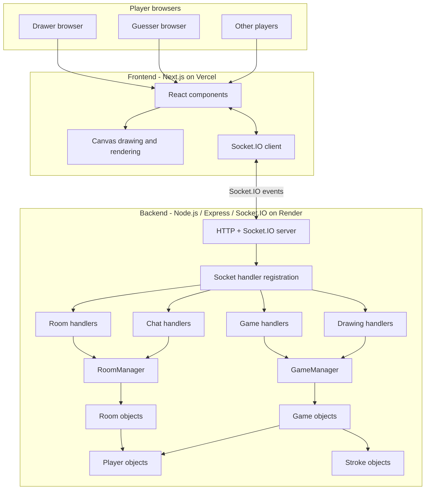

### Server-authoritative state management

The backend is the **source of truth** for game-critical state. The frontend may keep React state for rendering and local interaction, but it must not be trusted to decide game outcomes.

| State / decision       | Authoritative backend responsibility                                                          | Frontend responsibility                                      |
| ---------------------- | --------------------------------------------------------------------------------------------- | ------------------------------------------------------------ |
| Rooms and room status  | Create, join, leave, close, and manage room status                                            | Display room and status                                      |
| Players and membership | Validate membership; maintain player records                                                  | Render player list and connection indicators                 |
| Host permissions       | Verify host before start/kick/end-round actions                                               | Show host-only controls as a UI convenience                  |
| Drawer selection       | Select current drawer and round order                                                         | Display drawer name and drawing controls                     |
| Secret word            | Generate options, validate choice, keep selected word in game state                           | Show options/word only to drawer when received               |
| Strokes                | Validate drawing permissions, create stroke IDs, store stroke history, handle undo/redo/clear | Capture pointer input, render strokes, send drawing requests |
| Chat                   | Validate room membership and broadcast messages                                               | Input and display chat messages                              |
| Guesses                | Compare guesses with secret word and track solved players                                     | Send guess text and show feedback                            |
| Scores                 | Calculate and update points                                                                   | Display score snapshots                                      |
| Timer                  | Start/stop/decrement timer and trigger round end                                              | Display timer updates                                        |
| Round transitions      | Decide when rounds end and begin                                                              | Show round/result state                                      |
| Winner and leaderboard | Sort scores and determine winner                                                              | Render final result                                          |

**Security boundary:** A frontend check such as `isDrawer`, `isHost`, or `canGuess` improves UX, but it is not authorization. A modified client can emit socket events manually. The backend must validate each sensitive event before changing state.

> This project uses in-memory state. Backend authority means the running backend process decides the game state; it does not mean the state is persisted across server restarts. Production hardening would also require stricter payload validation, rate limiting, and additional abuse prevention.

---

# Backend architecture

## Backend folder structure

```text
backend/
└── src/
    ├── app.ts
    ├── server.ts
    ├── classes/
    │   ├── Game.ts
    │   ├── GameManager.ts
    │   ├── managers.ts
    │   ├── Player.ts
    │   ├── Room.ts
    │   ├── RoomManager.ts
    │   └── Stroke.ts
    ├── handlers/
    │   ├── chat.handler.ts
    │   ├── draw.handler.ts
    │   ├── game.handler.ts
    │   └── room.handler.ts
    └── socketHandlers/
        └── registerSocketHandlers.ts
```

## Backend entry and socket setup

### `server.ts`

- Loads environment variables.
- Creates the Express HTTP server.
- Creates the Socket.IO server.
- Configures CORS using `CLIENT_URL`.
- Handles new socket connections.
- Calls `registerSocketHandlers()` for each connection.
- Starts listening on `PORT` (default `5000`).

### `app.ts`

- Configures Express middleware such as CORS and JSON parsing.
- Exposes `GET /` as a simple backend health check.
- Game operations are primarily Socket.IO events rather than REST endpoints.

### `socketHandlers/registerSocketHandlers.ts`

This file is the socket event wiring layer:

1. Registers room handlers.
2. Registers game handlers.
3. Registers drawing handlers.
4. Registers chat handlers.
5. Handles disconnects.
6. Removes the disconnected player from the room.
7. Removes the room/game when the room becomes empty.
8. Broadcasts the updated room and `room:playerLeft` to remaining players.

## Classes and managers

Classes separate the game domain and make operations easier to maintain.

| Class         | Purpose                                                                                                                                                 |
| ------------- | ------------------------------------------------------------------------------------------------------------------------------------------------------- |
| `Player`      | Stores socket ID, username, score, host flag, and connection status. Includes score update/reset methods.                                               |
| `Room`        | Stores room code, host ID, player map, capacity, total rounds, status, and associated game. Enforces room-level rules such as capacity and host checks. |
| `RoomManager` | Centralizes room creation, lookup, joining, leaving, deletion, and kick operations.                                                                     |
| `Game`        | Stores current round, drawer, selected word, word options, phase, timer, guessed players, strokes, and redo history.                                    |
| `GameManager` | Creates/retrieves/removes games, resets scores when starting, and selects the next drawer.                                                              |
| `Stroke`      | Represents a drawing stroke with ID, player ID, points, color, width, and pen/eraser tool.                                                              |
| `managers.ts` | Exports shared singleton instances of `RoomManager` and `GameManager` so handlers operate on the same in-memory state.                                  |

## Handler responsibilities

Handlers keep socket event logic separated by feature.

| Handler           | Main responsibilities                                                                                            |
| ----------------- | ---------------------------------------------------------------------------------------------------------------- |
| `room.handler.ts` | Create/join/sync/leave rooms, host kick, room snapshots, membership and room validation                          |
| `game.handler.ts` | Start game, select drawer, word options/selection, guesses, scoring, timer, round transitions, final leaderboard |
| `draw.handler.ts` | Validate drawer drawing actions; create strokes; handle undo, redo, clear; broadcast canvas updates              |
| `chat.handler.ts` | Validate room membership and broadcast chat messages                                                             |

### Backend request path

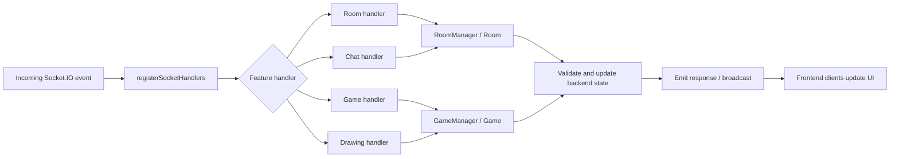

---

# Frontend architecture

## Frontend folder structure

```text
frontend/
├── public/
│   └── guessmasterlogo.png
└── src/
    ├── app/
    │   ├── [roomId]/
    │   │   └── page.tsx
    │   ├── globals.css
    │   ├── layout.tsx
    │   └── page.tsx
    ├── components/
    │   ├── ChatBox.tsx
    │   ├── GameCanvas.tsx
    │   ├── GameHeader.tsx
    │   ├── PlayerList.tsx
    │   └── RoomConfigForm.tsx
    └── lib/
        ├── hooks/
        │   └── useSocket.ts
        ├── socket/
        │   └── socket.ts
        └── types/
            └── game.ts
```

## Frontend components

| File                        | Responsibility                                                                |
| --------------------------- | ----------------------------------------------------------------------------- |
| `src/app/page.tsx`          | Home page and create/join room interface                                      |
| `src/app/[roomId]/page.tsx` | Main room/game page; subscribes to room/game events and stores UI state       |
| `RoomConfigForm.tsx`        | Nickname, room code, room capacity, rounds, create/join actions               |
| `GameHeader.tsx`            | Room code, round, timer, drawer label, invite button, drawer's word           |
| `GameCanvas.tsx`            | Canvas input/rendering, pen/eraser, color/width, undo/redo/clear controls     |
| `PlayerList.tsx`            | Players, host label, connection status, scores, host kick UI                  |
| `ChatBox.tsx`               | Waiting-room chat and in-game guess input/messages                            |
| `useSocket.ts`              | Socket connection status and current socket ID                                |
| `socket.ts`                 | Shared Socket.IO client instance and backend URL                              |
| `lib/types/game.ts`         | TypeScript interfaces for room, player, game, stroke, point, and message data |

## Frontend connection to backend

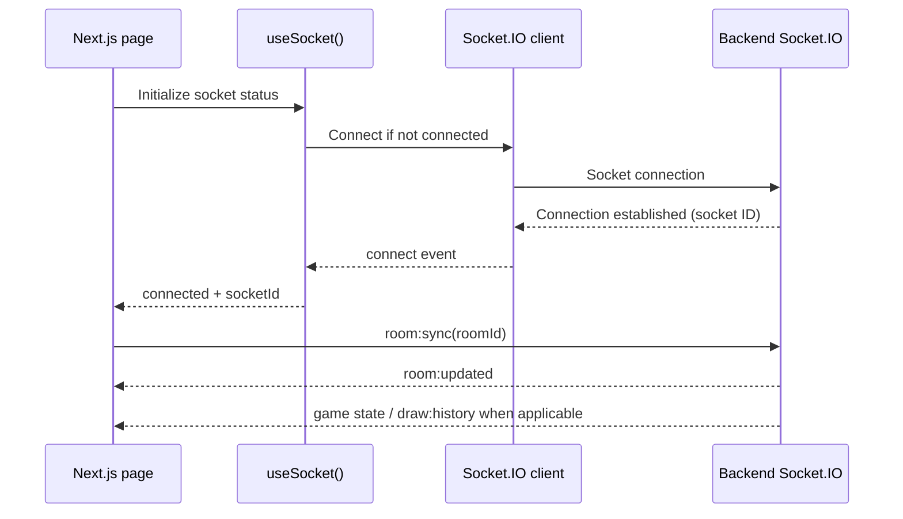

The client uses:

```ts
process.env.NEXT_PUBLIC_SOCKET_URL || "http://localhost:5000";
```

The production value must be the public backend URL. The frontend has reconnection settings, but the current backend identifies players by socket ID; reconnecting with a new socket ID is not a persistent identity/recovery system.

---

# Feature flows and diagrams

## 1. Room creation and joining

### Create room

1. User enters a nickname and selects max players and round count.
2. Frontend generates a room code and emits `room:create`.
3. Backend validates the request and creates a `Player`.
4. `RoomManager` creates a `Room` and adds the host.
5. Socket joins the Socket.IO room.
6. Backend stores room/player details in `socket.data`.
7. Backend emits `room:updated`.
8. Frontend renders the room and host controls.

### Join room

1. User enters nickname and room code.
2. Frontend emits `room:join`.
3. Backend checks room existence, waiting status, and capacity.
4. `RoomManager` adds the player.
5. Socket joins the Socket.IO room.
6. Backend stores room/player details in `socket.data`.
7. Backend broadcasts `room:updated`.
8. All clients update the player list.

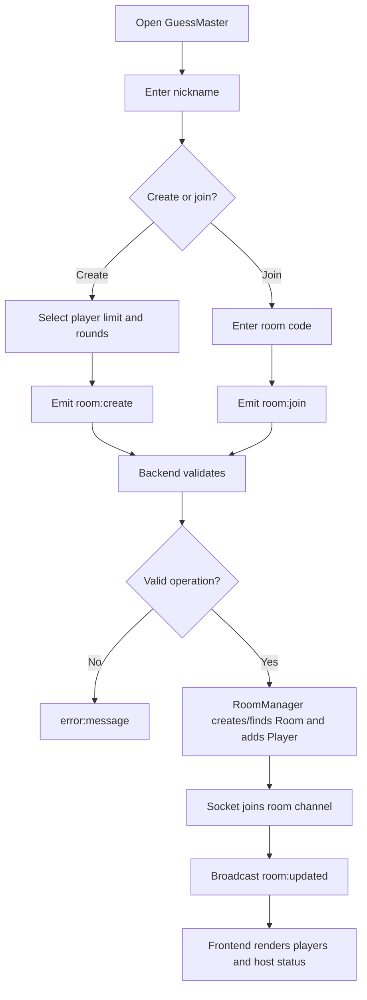

## 2. Room lifecycle and disconnects

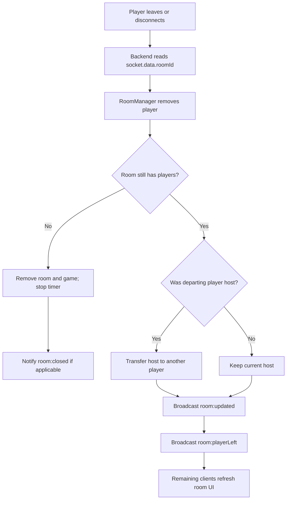

The room handler supports explicit leave and host kick. The socket disconnect handler removes the disconnected socket from the room. If the room is empty, the associated game is removed and its timer is stopped.

## 3. Game start and round lifecycle

1. Host emits `game:start`.
2. Backend checks host permission and that at least two players exist.
3. `GameManager` creates the game and resets player scores.
4. Backend emits `game:started`.
5. Backend selects the next drawer using player order.
6. `Game.startRound()` increments round, sets drawer, clears word/guess/stroke state, and sets phase to playing.
7. Backend broadcasts `game:roundStarting`.
8. Only the drawer receives `game:wordOptions`.
9. Drawer chooses a word; backend validates it against the options.
10. Backend privately sends `game:yourWord` to the drawer and starts the timer.

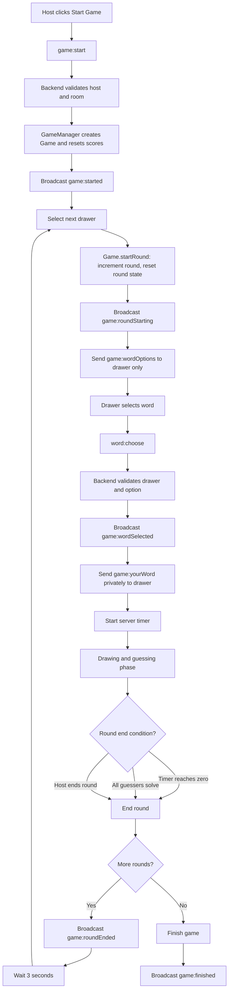

## 4. Drawing and stroke synchronization

### How the frontend captures drawing

1. `GameCanvas` receives `pointerdown`.
2. Drawing begins only if the socket is connected and `canDraw` is true.
3. Canvas pointer capture keeps the pointer interaction consistent.
4. Pointer coordinates are converted to canvas-relative points.
5. `pointermove` appends points and draws local segments immediately for responsive feedback.
6. Points are buffered in `pointsRef`.
7. On `pointerup` or `pointercancel`, the frontend emits one `draw:stroke` payload.
8. Backend validates the active drawer, game phase, selected word, and room association.
9. Backend creates a `Stroke` with a UUID and stores it in `Game.strokes`.
10. Backend broadcasts `draw:strokeReceived`.
11. Each frontend renders the stroke on its own canvas.

**Stroke timing:** The current implementation sends a stroke after the pointer is released. It does not stream each pointer movement to other players. The drawer sees local segments immediately; other players receive the completed stroke in realtime.

### Stroke representation

```ts
interface Stroke {
  id: string;
  playerId: string;
  points: { x: number; y: number }[];
  color: string;
  width: number;
  tool: "pen" | "eraser";
}
```

### Canvas rendering details

- `GameCanvas.tsx` uses the browser Canvas API.
- `lineCap` and `lineJoin` are set to `round`.
- Pen uses `source-over`.
- Eraser uses `destination-out`.
- Canvas is resized for device pixel ratio and redraws stored strokes.
- Stroke IDs prevent duplicate additions to the local stroke list.
- The frontend keeps a local copy of received stroke history for display.

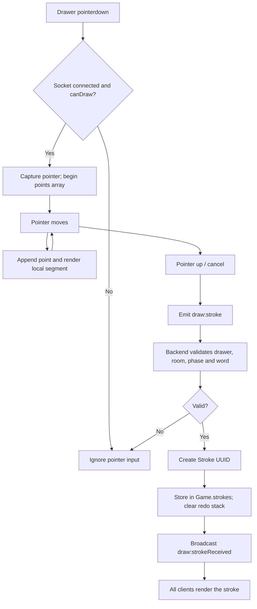

### Undo, redo, and clear

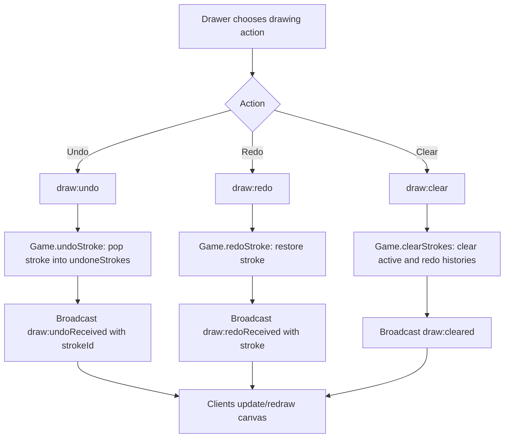

## 5. Chat and guessing

The chat input behaves differently depending on the game phase:

- In the waiting room, it emits `chat:message`.
- During gameplay, the input is used for guesses and emits `game:guess`.

### Normal chat flow

1. Frontend emits `chat:message`.
2. Backend verifies room and player membership.
3. Backend trims the message and ignores empty messages.
4. Backend broadcasts `chat:messageReceived`.
5. Clients display the message.

### Guess flow

1. Guesser submits text with `game:guess`.
2. Backend validates room membership, game phase, selected word, and player.
3. Drawer cannot guess their own word.
4. A player who has already guessed correctly cannot score again in that round.
5. Backend compares trimmed guesses case-insensitively.
6. Correct guess: guesser gets 10 points; drawer gets 5 points.
7. Backend broadcasts `game:correctGuess` and `game:scoresUpdated`.
8. If all non-drawer players guessed correctly, the round ends.
9. Incorrect guess is broadcast to other room members as `game:guessReceived`.

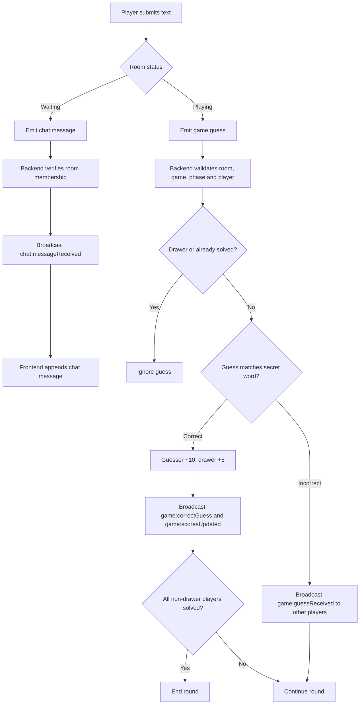

## 6. Timer and round end

The timer is **server-side and authoritative**:

- The backend starts a `setInterval` timer when the drawer selects a word.
- The backend decrements the timer every second.
- `game:timer` broadcasts the remaining seconds.
- The frontend updates timer state and displays it in `GameHeader`.
- The header highlights the timer when 10 seconds or less remain.
- When the timer reaches zero, the backend ends the round.
- The host can also request `game:endRound`; the backend checks host permission.

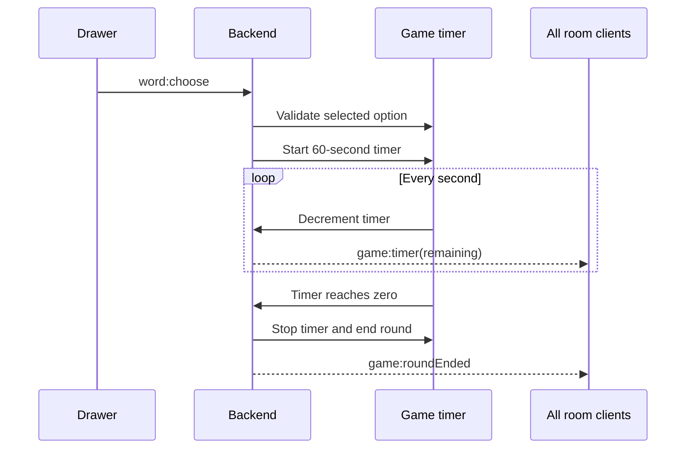

## 7. Scoring, round result, and winner

| Event                          |         Points |
| ------------------------------ | -------------: |
| Correct guess                  | +10 to guesser |
| Correct guess                  |   +5 to drawer |
| Incorrect guess                |              0 |
| Drawer guessing their own word |    Not allowed |

At round end:

1. Backend stops the timer and sets the game phase to waiting.
2. Backend broadcasts `game:roundEnded` with the word, round number, and score snapshot.
3. If rounds remain, the next round starts after a 3-second delay.
4. After the final round, backend finishes the game.
5. Backend sorts players by descending score.
6. The top player becomes the winner.
7. Backend broadcasts `game:finished` with leaderboard and winner.
8. Frontend renders the result.

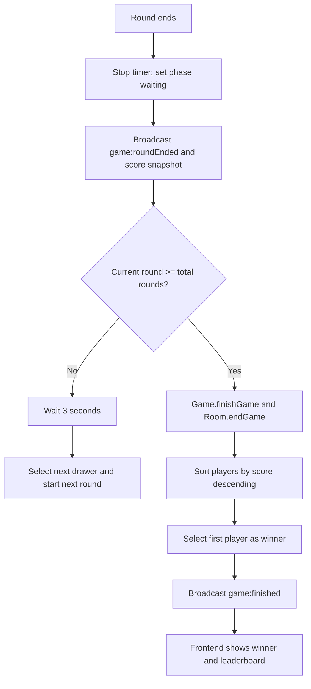

---

# Realtime event flow

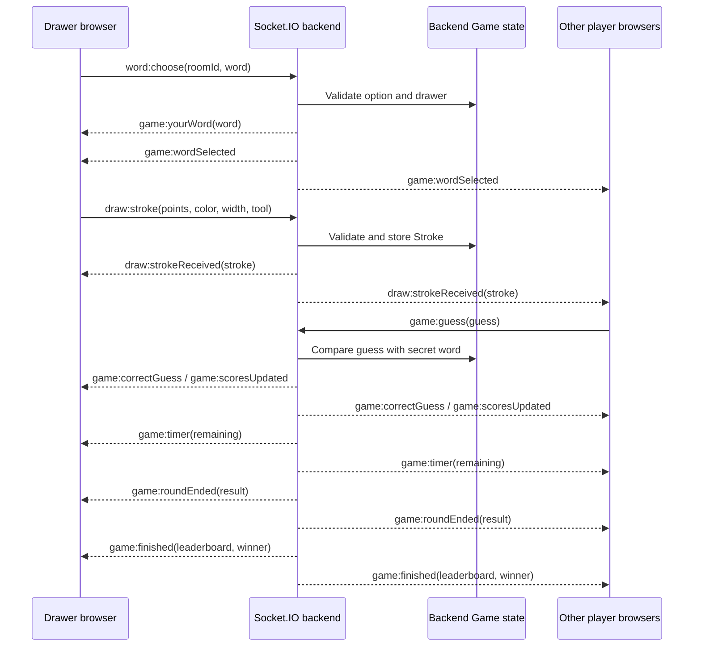

## Main Socket.IO event reference

| Event                  | Direction                   | Purpose                            |
| ---------------------- | --------------------------- | ---------------------------------- |
| `room:create`          | Client → server             | Create room and host player        |
| `room:join`            | Client → server             | Join a waiting room                |
| `room:sync`            | Client → server             | Request room/game synchronization  |
| `room:updated`         | Server → room/client        | Room/player snapshot               |
| `room:leave`           | Client → server             | Leave room                         |
| `room:kick`            | Host client → server        | Request kick                       |
| `room:kicked`          | Server → kicked client      | Notify removed player              |
| `room:playerKicked`    | Server → room               | Notify room of kick                |
| `room:playerLeft`      | Server → room               | Notify room of disconnect          |
| `room:closed`          | Server → room               | Room closed                        |
| `game:start`           | Host client → server        | Start game                         |
| `game:started`         | Server → room               | Game started                       |
| `game:roundStarting`   | Server → room               | Drawer and round info              |
| `game:wordOptions`     | Server → drawer             | Private word options               |
| `word:choose`          | Drawer → server             | Select word                        |
| `game:wordSelected`    | Server → room               | Word selection/timer state         |
| `game:yourWord`        | Server → drawer             | Private secret word                |
| `game:timer`           | Server → room               | Remaining seconds                  |
| `game:guess`           | Client → server             | Submit guess                       |
| `game:guessReceived`   | Server → other room members | Incorrect guess message            |
| `game:correctGuess`    | Server → room               | Correct guess notification         |
| `game:scoresUpdated`   | Server → room               | Updated scores                     |
| `game:endRound`        | Host client → server        | End round early                    |
| `game:roundEnded`      | Server → room               | Round result                       |
| `game:finished`        | Server → room               | Winner and leaderboard             |
| `draw:stroke`          | Drawer → server             | Submit completed stroke            |
| `draw:strokeReceived`  | Server → room               | Broadcast stroke                   |
| `draw:undo`            | Drawer → server             | Undo latest stroke                 |
| `draw:undoReceived`    | Server → room               | Remove stroke by ID                |
| `draw:redo`            | Drawer → server             | Redo stroke                        |
| `draw:redoReceived`    | Server → room               | Restore stroke                     |
| `draw:clear`           | Drawer → server             | Clear canvas history               |
| `draw:cleared`         | Server → room               | Clear canvas on clients            |
| `draw:history`         | Server → requesting client  | Synchronize stored strokes         |
| `chat:message`         | Client → server             | Send waiting-room chat             |
| `chat:messageReceived` | Server → room               | Broadcast chat message             |
| `error:message`        | Server → client             | Display operation/validation error |

---

# Deployment

GuessMaster uses separate deployment services for its frontend and backend.

## Live frontend

The Next.js frontend is deployed on **Vercel**.

🎮 **Play GuessMaster:** [https://guess-master-zeta.vercel.app/](https://guess-master-zeta.vercel.app/)

The frontend was previously deployed on Netlify and has now been migrated to Vercel.

## Backend

The Node.js, Express, and Socket.IO backend is deployed on **Render**.

The frontend connects to the backend using `NEXT_PUBLIC_SOCKET_URL`.

Configure the following environment variable in the Vercel project settings:

```env
NEXT_PUBLIC_SOCKET_URL=https://YOUR-BACKEND-URL
```

## Backend environment variables

Configure the following environment variables in the Render service:

```env
PORT=5000
CLIENT_URL=https://guess-master-zeta.vercel.app
```

### Deployment configuration

- `PORT` is the backend listening port; hosting providers may assign it automatically.
- `CLIENT_URL` should match the Vercel frontend origin configured for Socket.IO CORS.
- `NEXT_PUBLIC_SOCKET_URL` must contain the publicly accessible backend URL.
- Keep secrets and backend environment values in the hosting provider settings, not in Git.
- Redeploy the frontend after changing `NEXT_PUBLIC_SOCKET_URL`, because it is bundled at build time.
- Ensure the backend CORS configuration allows the deployed Vercel frontend origin.

---

# Local development

Run backend and frontend in separate terminals.

### Backend

```bash
cd backend
npm install
npm run dev
```

Default backend port: `5000`.

### Frontend

```bash
cd frontend
npm install
npm run dev
```

Default frontend URL: `http://localhost:3000`.

For local development:

```env
NEXT_PUBLIC_SOCKET_URL=http://localhost:5000
```

Use the scripts and package manager configured in each `package.json` if they differ from these examples.

---

# Current limitations and future improvements

- **In-memory state:** Rooms, players, games, scores, and strokes live in backend memory. Restarting the backend clears active games.
- **Single-instance assumption:** Multiple backend instances would not share in-memory rooms. Redis or another shared state layer and a Socket.IO adapter would be needed for horizontal scaling.
- **Reconnect identity:** The current implementation uses socket IDs as player IDs. A reconnect creates a new socket identity; durable reconnect/rejoin would need a separate player/session ID and recovery logic.
- **Stroke payload validation:** The backend checks drawing permissions and basic point-array presence. Production hardening should validate point count, coordinate ranges, color, width, tool values, and payload size.
- **Rate limiting:** Add per-socket limits for chat, guesses, and drawing actions to reduce spam/abuse.
- **Security:** Frontend role checks are only UI controls. All authorization must remain on the backend. Consider socket authentication, stronger input validation, and protection against malformed or oversized events.
- **Persistence:** Add a database only if game history, profiles, leaderboards, or persistent rooms are required.

---

## Summary

GuessMaster uses a **server-authoritative multiplayer architecture**:

- The backend owns room membership, host permissions, game phase, drawer, secret word, strokes, guesses, scores, timer, round transitions, and winner calculation.
- The frontend captures input and renders the current state.
- Socket.IO synchronizes events and state between players in realtime.
- Classes model domain objects; managers coordinate room/game operations; handlers keep socket event logic organized.
- The frontend is deployed on **Vercel**, while the backend is deployed on **Render**.

🎮 **Play GuessMaster:** https://guess-master-zeta.vercel.app/
